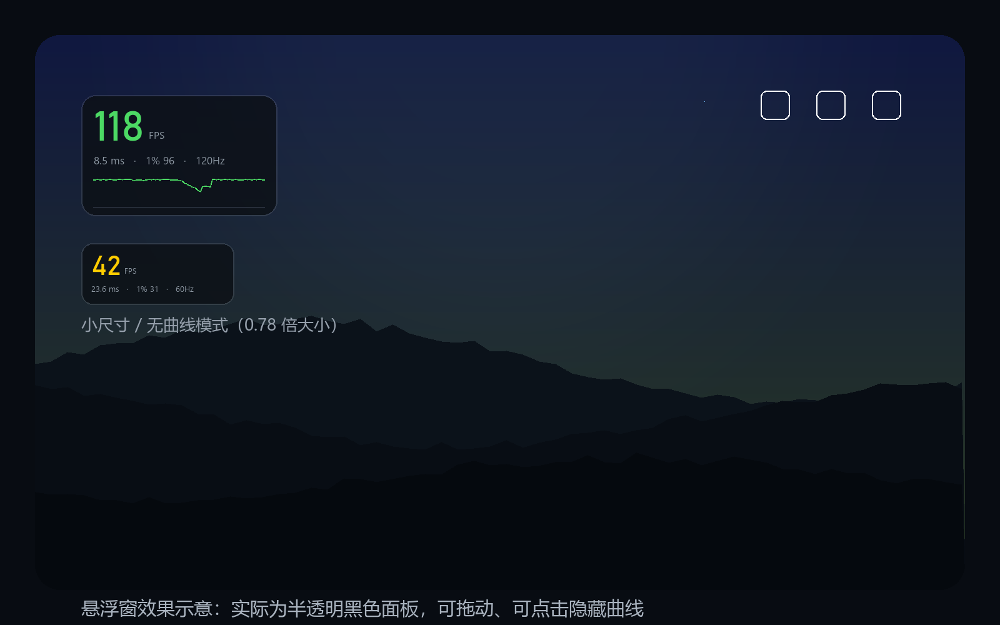

# 帧率悬浮窗（Android · 需 root）

给小平板用的**游戏实时帧率悬浮窗**：在游戏画面上叠一个可拖动的小面板，实时显示
**真实上屏帧率、帧时间、1% low** 和最近 90 次采样的帧率曲线。



> 这是完整可编译的 Android Studio 工程。本机没有 Android SDK，无法直接产出 APK，
> 请按下文「打包」三步操作，大约 3~5 分钟即可得到 `app-debug.apk`。

---

## 1. 它为什么准

大多数「帧率显示」App 用的是自己 App 的 `Choreographer` 回调，那测到的是**屏幕刷新率**
（60/90/120），跟游戏实际跑多少帧没关系。

这个 App 走的是另一条路：

```
su -c "dumpsys SurfaceFlinger --latency '<游戏图层名>'"
```

SurfaceFlinger 会为每个图层保留最近 128 帧的**期望上屏时间 / 实际上屏时间**（纳秒）。
相邻两帧的时间差就是这一帧真实的帧时间，倒数就是真实帧率。这和 PC 上 RTSS / PresentMon
统计 present FPS 是同一个数据源，所以数值可信，也不会受游戏自带帧率显示开关的影响。

图层名通过 `dumpsys SurfaceFlinger --list` 自动匹配当前前台游戏的包名，
匹配不到时可以在 App 里手动指定（「图层诊断」）。

---

## 2. 环境要求

| 项目 | 要求 |
| --- | --- |
| 平板 | Android 8.0（API 26）及以上 |
| 权限 | **已 root**（Magisk / KernelSU / APatch 均可），首次运行需在授权框里允许 |
| 打包电脑 | Windows / macOS 均可，装 Android Studio（Hedgehog 2023.1.1 或更新） |

不需要安装 Python、Node，也没有任何第三方依赖（工程是纯 Java + 系统 API，零 AndroidX）。

---

## 3. 打包

### 3.1 网络慢、不想下载 1.5GB 的 Android Studio？

可以完全跳过 IDE，用 GitHub 的服务器帮你打包（**本地 0 下载**）：

1. 注册 GitHub 账号（有就跳过），点 `New repository`，名字随便起，选 **Public**，Create；
2. 把工程解压后 `fps-overlay-android` **里面的所有文件**拖到仓库页面上传（`.github` 文件夹也要，它是隐藏目录，
   Windows 文件管理器里打开「显示隐藏项目」才看得到；上传时拖整个文件夹也行，脚本会自动找工程目录）；
3. 仓库页面 → `Actions` 标签 → 左边选 `build-apk` → 右侧 `Run workflow` → 绿色的 `Run workflow`；
4. 约 3~5 分钟跑完，点进这次运行，页面底部 **Artifacts** 下载 `fps-overlay-debug-apk`，解压就是 `app-debug.apk`。

> 这条路一次配置好，以后改代码推上去就自动出包，不用再碰 Android Studio。

### 3.2 用 Android Studio 打包（三步）

1. **打开工程**
   Android Studio → `File → Open` → 选择本目录 `fps-overlay-android`（不是里面的 app 目录）→
   弹「Trust project」选 `Trust`。

2. **等 Gradle 同步**
   首次会自动下载 Gradle 发行版和 Android SDK 34，等右下角进度条跑完。
   - 若提示 *Android SDK Platform 34 not installed* → 点 `Install missing platform`。
   - 若提示 *upgrade Android Gradle Plugin* → 可以 **忽略/取消**，当前 AGP 8.2.2 是可用的。
   - 若提示找不到 Gradle wrapper → 选 *Use Gradle from: 'gradle-wrapper.properties' file* 后让它自动生成，
     或者直接用 Studio 自带的 Gradle 同步。

3. **出包**
   菜单 `Build → Build Bundle(s) / APK(s) → Build APK(s)`，完成后点弹窗里的 `locate`，
   文件在：

   ```
   fps-overlay-android/app/build/outputs/apk/debug/app-debug.apk
   ```

   有数据线的话也可以直接 `Build → Run 'app'` 装到平板上；或者手动：

   ```bash
   adb install -r app-debug.apk
   ```

> 这个 debug 包已经用调试证书签过名，可以直接安装。想发正式版就 `Build → Generate Signed Bundle/APK`。

---

## 4. 使用

1. 打开 App → 点「开启悬浮窗」→ 系统弹出「显示在其他应用上层」授权，允许。
2. 同一次点击会触发 **root 授权**（Magisk 弹窗），选「允许」，并建议勾选「记住选择」。
3. 回到游戏，悬浮窗会在 1~2 秒内自动识别游戏图层并开始刷新。
4. 交互：
   - **拖动**：移动位置（松手后自动吸附在屏幕内，位置会记住）
   - **轻点**：开关底部的帧率曲线
   - **通知栏**：可直接关闭悬浮窗

面板内容：大号数字是当前 FPS（<20 时带一位小数），下面一行是
`平均帧时间 · 1% low · 屏幕刷新率`，底部是最近 36 秒（90 次采样）的帧率曲线。

颜色含义（相对屏幕刷新率自动判断）：

- 绿色：≥ 90% 刷新率，满帧
- 黄色：60%~90%，有掉帧
- 红色：< 60%，明显卡顿

---

## 5. 读不到帧数怎么办

先看状态栏文案，按提示排查：

| 界面提示 | 处理 |
| --- | --- |
| `未获得 root 权限` | 到 Magisk → 超级用户 → 找到本 App → 允许；再回 App 重开悬浮窗 |
| `没有找到游戏图层` | 确认游戏已经在前台；点「图层诊断 / 手动选择」，在列表里挑名字里带游戏包名、且以 `SurfaceView[` 开头的那一项 |
| `画面没有新帧（可能已暂停）` | 游戏真的暂停了；或者选错了图层 |
| 数值一直是 0 / 不动 | 换一个图层试试，通常是选了 `Background for SurfaceView[...]`（已自动过滤，但个别机型会漏） |
| 曲线有但数字偏低 | 游戏在播 CG / 加载，或者开了帧率上限（这类场景 FPS 本来就是这样） |

「图层诊断」里点任何一项会把该图层**锁定**，想恢复自动识别就选第一项「自动识别（推荐）」。

### 关于 dumpsys 的兼容性

- Android 8 ~ 15 上 `--latency` 都可用，root 下不需要额外权限。
- 个别定制 ROM（尤其部分国产 ROM）会裁剪 dumpsys 子命令。此时「图层诊断」会提示读取失败，
  可以带上 `adb shell su -c "dumpsys SurfaceFlinger --latency"` 的原始输出反馈，一般加一条解析分支就能适配。
- 游戏用 Vulkan / OpenGL ES 都无所谓，因为读的是系统合成层，与游戏渲染后端无关。

---

## 6. 开销与局限

- **开销**：每 400ms 执行一条 dumpsys（约 30~80ms），加上一个前台服务。对帧率的影响通常在
  1 帧以内，基本不可感知；长时间游戏建议把平板加入电池优化白名单，避免被后台清理。
- **数据含义**：显示的是「实际上屏帧率」。如果游戏开了动态分辨率 / 帧率上限 / 垂直同步，
  看到的就是最终上屏的结果，这本来也是玩家真正感知到的东西。
- **不适用**：分屏、悬浮小窗同时跑两个游戏时，只会采样到当前前台那个图层。

---

## 7. 目录结构

```
fps-overlay-android/
├─ settings.gradle / build.gradle / gradle.properties   # 工程配置（AGP 8.2.2，零依赖）
└─ app/
   ├─ build.gradle
   └─ src/main/
      ├─ AndroidManifest.xml                            # 悬浮窗 + 前台服务声明
      ├─ java/com/dsh/fpsoverlay/
      │  ├─ MainActivity.java      # 设置页：授权、开关、大小、图层诊断
      │  ├─ OverlayService.java    # 前台服务：持有窗口、拖动、通知
      │  ├─ OverlayView.java       # 自绘面板：数字 / 帧时间 / 曲线
      │  ├─ FpsEngine.java         # 轮询 + 滑动窗口统计（FPS / 帧时间 / 1% low）
      │  ├─ SurfaceFlinger.java    # 图层枚举、前台应用识别、--latency 解析
      │  ├─ RootShell.java         # su 执行封装（带超时）
      │  └─ Prefs.java             # 设置存储
      └─ res/                      # 布局、图标、文案
```

---

## 8. 可以继续加的东西

- 帧率曲线历史记录 / 导出 CSV（做benchmark 报告）
- 无 root 降级模式（Shizuku 或 MediaProjection 逐帧比对，精度会下降）
- 温度、CPU/GPU 占用、功耗并排显示
- 平板 + PC 双端：平板只当大屏，数据走局域网
